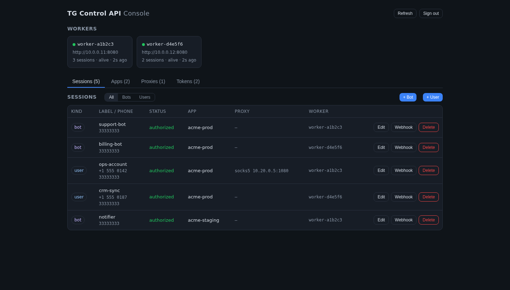
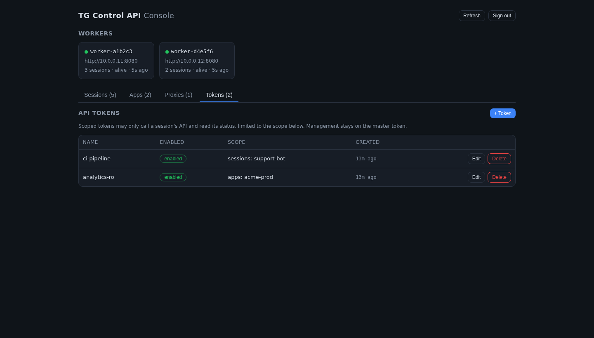

# Telegram Control API Server

[](https://github.com/FINWAX/tg-control-api-server/actions/workflows/ci.yml)

A containerized internal service that exposes an HTTP interface to Telegram
**user accounts** (like TelegramApiServer) and **bots** (like the tdlight Bot
API) over a single engine — TDLib. Credentials, session persistence, and
authorization are all handled server-side. Aimed at self-hosted deployments of
**under ~50 accounts**.

The public surface is native td_api JSON: you send a method name plus params and
the service dispatches it on the right session. User and bot sessions never mix.

## Management console

An optional web console (Next.js served by Caddy) manages sessions, apps,
proxies, workers, and scoped API tokens — no curl required. Enable it with the
`ui` compose profile (see [Running](#running)).



The login dialog follows the live state of the session on its worker: a rejected
code or password can be retyped on the spot, a lost code can be re-sent once its
timer runs out, and closing the dialog only minimizes it — the session stays in
`awaiting_code` / `awaiting_password` and **Log in** reopens it from the list,
including after a reload. See [Recovering a login](#recovering-a-login).

Scoped API tokens grant per-session or per-app access, separate from the master
token:



## Architecture

Two planes, split into separate containers:

- **gateway** (`cmd/gateway`) — stateless control plane. Holds no TDLib clients.
  Terminates auth, serves registry reads/writes straight from Postgres, and
  reverse-proxies session-scoped requests to the worker that owns the session.
- **worker** (`cmd/worker`) — data plane. Owns live TDLib clients (one per
  account), drives login, delivers update webhooks, and claims orphaned sessions
  from the registry. Horizontally scalable; see [Scaling workers](#scaling-workers).

Supporting pieces: **Postgres** is the registry and ownership lease (apps,
proxies, sessions, workers, webhook deliveries, API tokens). Secrets
(api_hash, bot tokens, proxy passwords, session DB keys) are encrypted with
AES-256-GCM using a master key from the environment and never leave the service
in plaintext. Each account gets its own TDLib database directory, and each session
can run through its own dedicated proxy (optional, but supported per session so up
to ~50 accounts can each present from a distinct IP).

```
client ──HTTP──> gateway ──reverse-proxy──> worker ──CGO──> libtdjson ──> Telegram
                    │                          │
                    └────────── Postgres ──────┘   (registry + ownership lease)
```

Internals: `internal/api` (worker HTTP surface), `internal/router` (gateway
routing + auth), `internal/session` (worker manager + authorizer + reconciler),
`internal/store` (Postgres), `internal/secret` (AES-GCM), `internal/tdjson`
(raw td_api JSON dispatch).

## Prerequisites

- Docker + Docker Compose.
- No local Go/Node toolchain needed — everything builds in containers.

Pinned versions (do not drift): go-tdlib `v1.0.0-beta1` against image
`ghcr.io/zelenin/tdlib-docker:b498497-alpine` (TDLib `b498497`).

## Setup

```sh
cp .env.example .env
# Fill in .env — both values are `openssl rand -base64 32`:
#   MASTER_KEY  — AES-256 key for the secret store
#   API_TOKEN   — master bearer token for the gateway API
```

`.env` holds infra config only and is gitignored. Tenant credentials
(api_id/api_hash, bot tokens, phones, proxies) are **never** put in env — they
are sent to the API and stored encrypted in Postgres.

Postgres credentials are read from `POSTGRES_USER` / `POSTGRES_PASSWORD` /
`POSTGRES_DB` (dev-only defaults apply when unset); the `DATABASE_URL` the
services use is composed from them. Set them in `.env` for anything but local
development.

## Running

```sh
docker compose up -d --build          # gateway + postgres + workers
docker compose logs -f gateway        # follow logs
docker compose down                   # stop (volumes kept)
docker compose down -v                # stop and wipe data
```

Optional management console (Next.js served by Caddy, reverse-proxying the API):

```sh
docker compose --profile ui up -d     # console on http://localhost:3080
```

Sign in with the master `API_TOKEN`. The console manages sessions, apps, proxies,
workers, and scoped tokens without hand-rolling curl.

Toolchain smoke test:

```sh
docker build -t tg-control-api-server . && docker run --rm tg-control-api-server ./smoke
```

The gateway and workers expose a `/healthz` liveness endpoint and ship with
Compose healthchecks, so `docker compose ps` reflects real readiness and the
console only starts once the gateway is healthy.

## Quickstart

With the stack up, point at the gateway and set your master token:

```sh
export G=http://localhost:8080
export TOKEN=<your API_TOKEN from .env>
```

**1. Register a Telegram app** (get `api_id`/`api_hash` from <https://my.telegram.org>):

```sh
curl -s "$G/v1/apps" -H "Authorization: Bearer $TOKEN" \
  -d '{"api_id":123456,"api_hash":"...","label":"main"}'        # -> {app_id}
```

**2. Register a proxy** (optional, one per session recommended for user accounts):

```sh
curl -s "$G/v1/proxies" -H "Authorization: Bearer $TOKEN" \
  -d '{"type":"socks5","host":"1.2.3.4","port":1080,"username":"u","password":"p"}'  # -> {proxy_id}
```

**3. Create a session.** A **bot** logs in non-interactively:

```sh
curl -s "$G/v1/bot" -H "Authorization: Bearer $TOKEN" \
  -d '{"token":"<bot_token>","app_id":"<app_id>","proxy_id":"<proxy_id>"}'   # -> {id, status:authorized, me}
```

A **user** needs the login code (and the 2FA password if set):

```sh
curl -s "$G/v1/user" -H "Authorization: Bearer $TOKEN" \
  -d '{"app_id":"<app_id>","phone":"+1555...","proxy_id":"<proxy_id>"}'  # -> {id, status:awaiting_code, code_info}
curl -s "$G/v1/user/<id>/login/code"     -H "Authorization: Bearer $TOKEN" -d '{"code":"12345"}'
curl -s "$G/v1/user/<id>/login/password" -H "Authorization: Bearer $TOKEN" -d '{"password":"..."}'   # only if 2FA
```

Save the session `id` as `$SID`. See [Recovering a login](#recovering-a-login)
for what to do when the code is wrong, late, or lost.

**4. Call any td_api method** on the session — the method name is resolved
dynamically, so the full td_api surface is available:

```sh
curl -s "$G/v1/bot/$SID/call" -H "Authorization: Bearer $TOKEN" \
  -d '{"method":"getMe","params":{}}'          # user sessions use /v1/user/$SID/call
```

**5. Receive updates** (new messages, etc.) by subscribing a webhook:

```sh
curl -s -X POST "$G/v1/bot/$SID/updates/subscriptions" -H "Authorization: Bearer $TOKEN" \
  -d '{"url":"https://your-app/telegram","filters":{"types":["updateNewMessage"]}}'
```

The answer carries the subscription's generated secret, shown once; see
[Receiving updates](#receiving-updates).

From here: [send media](#sending-files), [download / crawl](#downloading-files-crawling),
issue [scoped tokens](#api-tokens), or drive it all from the
[console](#management-console).

## Data and upgrades

State lives in two named volumes: `pgdata` (the Postgres registry — apps,
proxies, sessions, tokens, encrypted secrets) and `tdlibdata` (per-account TDLib
databases). Both persist across `up`/`down` and image rebuilds; `down -v` wipes
them.

The database schema is **versioned and migrated automatically** on startup:
each release applies only the migrations newer than what the database already
has, in order, once each (tracked in `schema_migration`, serialized across
gateway/workers by an advisory lock). Migrations are forward-only and additive,
so upgrading to a newer image never drops or rewrites existing data — just
`docker compose pull && docker compose up -d`.

**Do not bind-mount `pgdata` / `tdlibdata` to a Windows or macOS drive** under
Docker Desktop. TDLib's binlog and Postgres rely on POSIX atomic-rename and
locking, which the Windows/macOS file-sharing bridge does not provide — it
causes fatal binlog-rename crashes in the workers and can corrupt Postgres. Use
named volumes (they live on the Linux VM's filesystem) and, if you need a
host-path copy for portability or backup, export them on a schedule with
`pg_dump` and `tar` rather than binding the live data. Bind mounts to a **native
Linux path** are fine.

## Development

Unit tests link libtdjson (CGO), so they run inside the build image rather than
on the host:

```sh
./scripts/test.sh              # unit tests (go test ./...) in the toolchain image
./scripts/test-integration.sh  # Postgres-backed store tests against a throwaway DB
./scripts/footprint.sh         # measure per-account memory / disk of a running stack
```

## API

Every request except `GET /healthz` must carry `Authorization: Bearer <token>`.

| Method & path | Purpose |
| --- | --- |
| `GET  /healthz` | Liveness (no auth) |
| `POST /v1/apps` `{api_id, api_hash, label}` | Register a Telegram app → `{app_id}` |
| `POST /v1/proxies` `{type, host, port, username?, password?, secret?, label?}` | Register a proxy → `{proxy_id}` |
| `POST /v1/bot` `{token, app_id, proxy_id?, label?}` | Create + log in a bot → `{id, status, me}` |
| `POST /v1/user` `{app_id, phone, proxy_id?, label?}` | Start a user login → `{id, status, code_info}` |
| `POST /v1/user/{id}/login/code` `{code}` | Submit the login code |
| `POST /v1/user/{id}/login/password` `{password}` | Submit the 2FA password |
| `POST /v1/user/{id}/login/resend` | Re-send the code on the same login attempt |
| `POST /v1/{user\|bot}/{id}/call` `{method, params}` | Async td_api call on the session |
| `GET /v1/{user\|bot}/{id}/sends?chat_id=&message_id=` | Resolve a sent message's temporary id (see [Message ids after a send](#message-ids-after-a-send)) |
| `POST /v1/execute` `{method, params}` | Synchronous td_api call (no session) |
| `POST /v1/files?name=` | Upload a file → `{path}` (single-shot; see [Sending files](#sending-files)) |
| `PATCH/GET /v1/files/{id}`, `POST /v1/files/{id}/complete`, `DELETE /v1/files/{id}` | Resumable/chunked upload |
| `GET /v1/{user\|bot}/{id}/files/{file_id}` | Download a file, streamed with Range (see [Downloading files](#downloading-files-crawling)) |
| `POST/GET /v1/{user\|bot}/{id}/updates/subscriptions`, `GET/DELETE .../subscriptions/{sub}` | Update webhooks (see [Receiving updates](#receiving-updates)) |
| `GET  /v1/{user\|bot}/{id}` | Session state → `{id, status, code_info?, last_error?}` |
| `PATCH /v1/{user\|bot}/{id}` `{label?, proxy_id?}` | Rename / change proxy (applied live) |
| `DELETE /v1/{user\|bot}/{id}` | Close and remove a session |
| `GET  /v1/{sessions\|apps\|proxies\|workers}` | Registry listings (no secrets) |
| `PATCH /v1/{apps\|proxies}/{id}` `{label}` | Rename |
| `GET/POST/PATCH/DELETE /v1/tokens` | Scoped API token CRUD |

Session-scoped paths carry the session's kind: addressing a `user` session as
`/v1/bot/{id}` (or the reverse) is a `404`, not a silently accepted call. Use the
kind reported by `GET /v1/sessions`.

### Response envelope

Success is `{"ok": true, "result": ...}`. Failure is:

```jsonc
{"ok": false, "error": {
  "message": "Chat not found",  // human-readable, from TDLib or this service
  "source": "tdlib",            // "tdlib" = Telegram refused; "gateway" = this service
  "code": 400,                  // TDLib error code — present only when source is "tdlib"
  "retry_after": 3600           // seconds; only on a flood wait (code 429), also sent as Retry-After
}}
```

`source` is the field to branch on: `"gateway"` means the request never reached
Telegram (bad input, unknown session, no live worker) and is often retryable as
is; `"tdlib"` means Telegram itself rejected it. The HTTP status mirrors `code`
for TDLib errors.

**A call may take up to a minute.** TDLib sits out Telegram's short flood waits
itself, resending once the wait is over, as long as the total stays within 60
seconds; the call simply answers late. A longer wait comes back as `429` with
`retry_after`. Give `/call` a client timeout of at least 75 seconds, so a call
TDLib is still waiting out is not abandoned and repeated.

Note that TDLib packs most refusals into `code: 400` regardless of cause, so
distinguishing e.g. *Chat not found* from *CHANNEL_PRIVATE* still requires
matching on `message`. Waits and infrastructure failures, which is where retry
decisions actually matter, are covered by `retry_after` and `source`.

### Choosing `/call` vs `/execute`

`POST /v1/{user|bot}/{id}/call` reaches **every** td_api method — including the
synchronous ones such as `parseTextEntities`, which work fine on a live session —
except those the gateway reserves for itself (session lifecycle, authentication,
proxy, and logging methods; they answer `403`).

`POST /v1/execute` is `td_execute`: local computation with no session and no
account state, for the ~28 synchronous methods only. Reach for it when no session
exists yet — otherwise just use `/call`. Both accept scoped tokens.

### Message ids after a send

**The `id` a send returns is temporary.** This is td_api's model, not a quirk of
this service: `sendMessage` answers as soon as TDLib has queued the message, long
before Telegram has accepted it, and the id in that answer is local to the
session. The real, server-assigned id arrives later on the update stream. Nothing
lasting can be done with the temporary one — you cannot edit, delete, or reply to
a message by it, and it matches nothing in chat history.

You can tell the two apart without asking: while a message is in flight it
carries `"sending_state": {"@type": "messageSendingStatePending"}`. Once it has
landed, `sending_state` is gone.

`/call` stays a faithful td_api passthrough and returns that answer unchanged.
To learn what the id became, ask:

```sh
# {"ok":true,"result":{"@type":"message","id":1048576,"chat_id":-1001234567890,
#                      "sending_state":{"@type":"messageSendingStatePending",...}}}
curl -s "$G/v1/user/$SID/sends?chat_id=-1001234567890&message_id=1048576" \
  -H "Authorization: Bearer $TOKEN"
```

```jsonc
{"status": "pending"}                                    // still on its way — poll again
{"status": "sent",   "chat_id": -1001…, "message_id": 8589934592}  // the durable id
{"status": "failed", "chat_id": -1001…, "error": {"code": 400, "message": "CHAT_WRITE_FORBIDDEN", "source": "tdlib"}}
```

A `404` means the send is unknown — a wrong id, or one older than `SEND_TTL`
(default 7 days). That is deliberately distinct from `pending`, so a client
never polls forever.

The `failed` branch matters as much as the id: a send that Telegram ultimately
rejects still answers `200` at `/call`, because at that moment nothing had gone
wrong yet. Resolving is the only way to learn it never landed without
[subscribing to updates](#receiving-updates) — `updateMessageSendSucceeded` and
`updateMessageSendFailed` carry the same outcome.

How long `pending` lasts is the upload, not the send. A text message resolves in
well under a second; media resolves only once TDLib has pushed the bytes to
Telegram, which for a large file can be minutes. Nothing blocks meanwhile —
`/call` returned immediately — so for most callers the answer is simply to keep
polling, or to poll less often when the file is big.

Reach for `preliminaryUploadFile` only if you want **upload progress**. If you
do, note two things the td_api schema is explicit about and that are easy to get
wrong:

- `priority` is required and must be **1–32**; omitting it fails with *Priority
  must be between 1 and 32*. `file_type` may be `null`.
- **Do not wait for `remote.is_uploading_completed`.** By design it stays
  `false` until the file is actually sent in a message, so waiting on it never
  finishes. Judge readiness by `remote.uploaded_size` reaching the file size.
  The file is usable in `inputFileId` well before then.

Sends are tracked per chat, because td_api message ids are unique within a chat
rather than globally; that is why `chat_id` is required. Album sends
(`sendMessageAlbum`) return several messages, each resolved separately.
Scheduled messages are not tracked: they stay pending until their send time.

### Addressing chats

`chat_id` accepts either a username (`"@my_channel"`, resolved via
`searchPublicChat`) or a numeric id — private chat, basic group, or the familiar
`-100…` supergroup/channel form.

TDLib lazy-loads dialogs, so a valid numeric id can answer *Chat not found*,
*Chat info not found* or *CHANNEL_INVALID* until something materializes the chat
object. `/call` handles all three for you: it decodes the peer type from the id,
force-loads the chat (`createPrivateChat` / `createBasicGroupChat` /
`createSupergroupChat`) and retries once. Clients do not need to know the id
encoding or warm chats up.

This works when the account already holds the peer's access hash — it is a member
of the chat, or has seen it. That knowledge is kept across restarts (TDLib's
chat-info database is enabled), so a session that could address a chat before a
restart can still address it after one. A never-seen **private** channel cannot
be reached from its numeric id alone (a Telegram protocol constraint); join it, or
address a public one by `@username`.

**Bots are more restricted than user accounts here.** A bot has no dialog list —
`loadChats` answers *The method is not available to bots* — and an access hash
cannot be derived from a numeric id. So a bot that has never seen a chat can only
reach it via `searchPublicChat` on its `@username` (public chats), or after an
update arrives from that chat. Passing `"@username"` as `chat_id` does this for
you.

*Not enough rights…* is not retried, because Telegram uses that same message both
for a genuine permission failure and for a chat whose rights are not loaded yet,
with nothing machine-readable to tell them apart. If you see it right after a
restart on a chat that used to work, resolve the chat once by `@username`.

### Checking whether a session may post

There is no gateway endpoint for this — it is a plain td_api question, so ask it
through `/call`:

- **Ordinary member:** `getChat` → `chat.permissions.can_send_basic_messages`.
  Careful: `chat.permissions` describes what *ordinary members* may do. In a
  channel it reads `false` even for an account that can post perfectly well as an
  administrator, so using it alone gives a false negative — exactly the wrong
  answer for the common "bot posting to a channel" case.
- **Administrator (the usual case for a bot in a channel):** `getChatMember` →
  `status`, which answers `chatMemberStatusAdministrator`. Note the parameter is
  `member_id`, a **MessageSender object**, not a bare `user_id`:

  ```json
  {"method": "getChatMember", "params": {
    "chat_id": -1001234567890,
    "member_id": {"@type": "messageSenderUser", "user_id": 123456789}
  }}
  ```

  Passing `user_id` at the top level is not the field td_api expects; the call
  comes back as *Message sender must be non-empty* (or *Member not found*).

Both reads need the chat resolved first, so the same rules as above apply.

### Recovering a login

Telegram rations login codes, so a started user login is treated as an asset:
nothing here throws one away on your behalf.

**A wrong code or password does not end the login.** The submit answers with
Telegram's own refusal (`source: "tdlib"`, e.g. `PHONE_CODE_INVALID` or
`PASSWORD_HASH_INVALID`) while the session stays in `awaiting_code` /
`awaiting_password`. Submit again with the corrected value — the attempt is
still the same one, and no new code is sent.

**A code that never arrived can be re-sent** on the same attempt:

```sh
curl -s -X POST "$G/v1/user/$SID/login/resend" -H "Authorization: Bearer $TOKEN"
```

Telegram refuses a resend until the timeout has elapsed. `code_info` tells you
when, and where the code went — it is the td_api `authenticationCodeInfo`,
returned by `POST /v1/user`, by every login step, and by the status read:

```jsonc
{"@type": "authenticationCodeInfo",
 "phone_number": "+1555…",
 "type": {"@type": "authenticationCodeTypeSms", "length": 5},  // where it went
 "next_type": {"@type": "authenticationCodeTypeCall"},         // what a resend uses
 "timeout": 60}                                                // seconds until a resend is allowed
```

**An interrupted client does not lose the login.** `awaiting_code` and
`awaiting_password` are recorded in the registry, so `GET /v1/sessions` and
`GET /v1/{user|bot}/{id}` both show that input is expected; resume by submitting
to the same session id. The status read also carries `last_error`, the reason
the previous attempt was refused.

**A repeated `POST /v1/user` for a number whose login is still unfinished is
refused** with `409` rather than costing a second code. The response names the
attempt to resume:

```jsonc
{"ok": false, "error": {"message": "a login for this phone is already waiting for input (session …)",
                        "source": "gateway", "session_id": "…"}}
```

An *authorized* number is not refused — one number may hold several sessions.

**Giving up is explicit:** `DELETE /v1/user/{id}` closes the pending login and
removes the session. A login whose worker dies is written off automatically
(status `expired`), since only that worker could have delivered the code.

## Sending files

TDLib sends media from a **file on the owning worker's disk** (`inputFileLocal`),
never as bytes inline in a `/call`. To make that work as a pure HTTP API, upload
the file first: the gateway writes it to a volume shared with the workers, and
the owning worker reads it back locally — so the bytes cross the network once
(client → gateway), not again to the worker.

**Small/medium files — single-shot:**

```sh
curl -sX POST "$G/v1/files?name=pic.jpg" -H "Authorization: Bearer $TOKEN" \
     --data-binary @pic.jpg
# -> { "ok": true, "result": { "path": "/uploads/<id>/pic.jpg", "size": 12345 } }
```

Then reference the returned `path`:

```sh
curl -sX POST "$G/v1/bot/$SID/call" -H "Authorization: Bearer $TOKEN" -d '{
  "method": "sendMessage",
  "params": { "chat_id": "@my_channel", "input_message_content": {
    "@type": "inputMessagePhoto",
    "photo": { "@type": "inputFileLocal", "path": "/uploads/<id>/pic.jpg" }
  }}}'
```

**Large files (up to 2 GiB) — resumable/chunked** (survives network drops):

1. `POST /v1/files?name=movie.mp4` with header `Upload-Length: <bytes>` → `{upload_id, chunk_size}`
2. `PATCH /v1/files/<upload_id>` with header `Upload-Offset: <n>` and a chunk body, repeatedly
3. `GET /v1/files/<upload_id>` → `{offset}` to resume after an interruption
4. `POST /v1/files/<upload_id>/complete` → `{path}` (verifies the full length)

`PATCH` answers with the **new absolute offset** — the total bytes now on disk,
not the size of the chunk just sent — as `{"offset": n}` and in an `Upload-Offset`
response header. Send the next chunk from that value. A `PATCH` whose
`Upload-Offset` doesn't match the current end of the file is rejected with `409`
rather than written out of order: re-read `GET /v1/files/<upload_id>` and resume
from the offset it reports.

**By URL (no upload):** pass `{"@type":"inputFileRemote","id":"https://…"}` as the
file and TDLib fetches it directly.

Uploaded files are single-use: reuse the same media across chats via the Telegram
`remote` file id returned in the first send (`inputFileRemote`), not the local
file. A file is removed as soon as its send completes; anything never sent is
swept after `UPLOAD_TTL` (default 2h). `inputFileLocal` paths are confined to the
uploads volume — a `/call` cannot reference any other path on the worker.

Filenames keep their real name (the upload id lives in the directory, not the
filename), capped at the filesystem's 255-byte limit; Telegram truncates long
document names on its side.

## Downloading files (crawling)

Incoming media is referenced by a `file` object on the message: a local `id`
(ephemeral, this session run), `remote.id` (a persistent reference), and
`remote.unique_id` (a stable content fingerprint — the dedup key). Discover
messages with `getChatHistory` / `searchChatMessages` (or in real time via the
update webhook), then download.

Stream a file straight from the owning worker's disk, with HTTP `Range` support:

```sh
# by the local file id from a message
curl -s "$G/v1/user/$SID/files/1234" -H "Authorization: Bearer $TOKEN" -o out.jpg

# by the persistent remote id (works later / after a restart, no live file_id)
curl -s "$G/v1/user/$SID/files/0?remote_id=<remote_id>" \
     -H "Authorization: Bearer $TOKEN" -o out.jpg

# add &delete=1 to drop the file from TDLib storage after a full download
```

The download is synchronous (it blocks until TDLib has the whole file) and the
bytes stream back — no base64. `Range` requests return `206 Partial Content`, so
a large download can resume. For a crawl, persist `remote.id` (to re-fetch) and
`remote.unique_id` (to skip duplicates); if a `remote.id` ever returns *file
reference expired*, re-read the source message to refresh it. Bound disk during a
crawl with `?delete=1`, or `deleteFile` / `optimizeStorage` via `/call`.

The lower-level td_api path also works directly through `/call` (`downloadFile`
→ `readFilePart`), but returns bytes as base64 in JSON — the streaming endpoint
above is preferred for anything but small files.

## Receiving updates

Updates — new messages, join requests, send outcomes, anything td_api emits —
are pushed to webhook **subscriptions**. A session can have several, each with
its own URL, secret and filter, so every consumer of an account gets its own
stream.

```sh
curl -s -X POST "$G/v1/bot/$SID/updates/subscriptions" -H "Authorization: Bearer $TOKEN" \
  -d '{"url":"https://your-app/telegram",
       "filters":{"types":["updateNewMessage"],"chats":[-1001234567890]}}'
# {"ok":true,"result":{"id":"<subscription id>","secret":"<generated>"}}
```

| Route | |
|---|---|
| `POST /v1/{user\|bot}/{id}/updates/subscriptions` `{url, secret?, filters?}` | Create → `{id, secret?}` |
| `GET /v1/{user\|bot}/{id}/updates/subscriptions` | List them, with delivery status |
| `GET /v1/{user\|bot}/{id}/updates/subscriptions/{sub}` | One, with delivery status |
| `DELETE /v1/{user\|bot}/{id}/updates/subscriptions/{sub}` | Remove it and whatever it still had queued |

A new subscription is live within a second.

**Secret.** Leave `secret` out and one is generated and returned — the only
time it is shown; it is stored encrypted. If you pass your own, give every
subscription a different one (see [Delivery](#delivery)).

**Filters** are two optional allowlists:

- `types` — update `@type`s. Empty: every type.
- `chats` — chat ids. An update's chat is its `chat_id`, else its
  `message.chat_id`. With a chat filter set, an update about no chat at all is
  **not** delivered: the filter means "only these chats".

Filter by type unless you really want everything. A user session emits tens of
thousands of updates as it starts — options, chat list sync, statuses — and an
unfiltered subscription is sent every one. A burst like that can outrun the
worker's buffer, which then shows up as `dropped`.

**Ownership.** A subscription belongs to the token that created it. A scoped
token manages subscriptions only on sessions its scope covers, and sees and
removes only its own; the master token sees them all. A subscription stops
being served as soon as its token is disabled or no longer covers the session —
checked at every delivery, not just at creation — and is removed together with
its token.

### Delivery

Each update is POSTed as the raw td_api `Update` JSON, with these headers:

| Header | |
|---|---|
| `X-Tgcontrol-Session` | Session id |
| `X-Tgcontrol-Kind` | `user` or `bot` |
| `X-Tgcontrol-Subscription` | Subscription id |
| `X-Tgcontrol-Delivery` | Delivery id — the same on every retry |
| `X-Tgcontrol-Attempt` | Attempt number, from 1 |
| `X-Tgcontrol-Signature` | `sha256=<hex>`: HMAC-SHA256 of the body, keyed with the subscription's secret |

Verify the signature against the raw body. It covers the body only, not the
headers — and the body, a raw `Update`, names neither session nor
subscription. What proves where a delivery came from is **which secret
verifies it**, which is why each subscription should have its own: with one
secret shared across subscriptions, the session header is an unauthenticated
claim that a replayed request could change.

Guarantees:

- **At least once.** Retries happen; deduplicate on `X-Tgcontrol-Delivery`.
- **Unordered.** A failed delivery is retried later, behind newer ones. Do not
  rely on arrival order.
- Any `2xx` counts as delivered; the response body is ignored. A request times
  out after 10 s — answer first, process afterwards.
- Up to 10 attempts, backing off from 5 s to 5 min. After that the delivery is
  `failed` and not retried.
- Receivers are isolated: a slow or unreachable URL delays only its own
  subscription, never another one of the same session or worker.
- Queued deliveries are kept for 24 hours, delivered or not.

Each subscription reports `last_delivered_at`, `last_error`, `last_error_at`,
`pending`, `failed`, and `dropped`. `dropped` counts updates the session lost
before they could be queued, when its worker's buffer overflowed. That loss
happens before an update is matched to subscriptions, so it is charged to every
subscription the session had at the time; a non-zero `dropped` means the stream
has a gap.

## API tokens

The `API_TOKEN` from env is the **master** token: full admin access.

Additional **scoped** tokens can be created (via `/v1/tokens` or the console).
A scoped token may invoke a session's `/call`, read its status, resolve its sends,
download its files, and manage its own update subscriptions — only for sessions
its scope covers. Scope is the union of:

- `all_sessions` — every session, or
- an explicit `session_ids` list, or
- `app_ids` — all sessions belonging to those apps.

Three routes are open to any enabled token regardless of scope: file uploads
(`/v1/files*`, which only become sendable through a session's `/call`),
`/v1/execute` (local computation touching no session), and `GET /v1/sessions`,
which is **filtered to the token's own grants** — so an integrator can discover
the full session ids and kinds it may address without being handed the master
token. Everything else (apps, proxies, tokens, session lifecycle) is master-only.

Each token has an `enabled` flag. Only the SHA-256 of a token's secret is stored;
the plaintext is shown once at creation.

## Scaling workers

Workers are stateless with respect to identity — each registers itself and the
reconciler rebalances sessions to a fair share (`ceil(total / live workers)`).
Set the count in `docker-compose.yml` (`deploy.replicas`) or override at runtime:

```sh
docker compose up -d --scale worker=4
```

Minimum one worker. Killing a worker (graceful or hard) fails its sessions over
to peers within seconds. All replicas share the `tdlibdata` volume, so this
assumes a single host; spreading across hosts would need shared storage.

## Requirements and resource footprint

The service is light: at the target scale (**under ~50 accounts, single host**)
host resources are not the binding constraint — Telegram's per-account rate
limits and proxy throughput are. Footprint is **linear in the number of
accounts**, and you can re-measure any running stack with
[`scripts/footprint.sh`](scripts/footprint.sh).

Measured baseline (idle containers, RSS):

| Component | Memory | Notes |
| --- | --- | --- |
| gateway | ~6 MiB | stateless, holds no TDLib clients |
| postgres | ~40 MiB | registry; grows slowly (KiB per account) |
| worker (base) | ~15 MiB | Go + libtdjson, before any session |
| ui (optional) | ~12 MiB | Caddy + static export |

Per account, on top of the worker base:

| Account type | Memory (RSS) | Disk (tdlibdata) |
| --- | --- | --- |
| **bot** | ~2–4 MiB | ~0.1 MiB |
| **user** | ~10–15 MiB | a few MiB, grows with the file cache |

User sessions are heavier and their disk grows as TDLib caches downloaded media
(message/chat databases are disabled by default; the file database is on — tune
in `buildParams`, [internal/session/manager.go](internal/session/manager.go)).
The `uploads` volume is transient: it holds in-flight uploads (up to
`MAX_UPLOAD_BYTES`, default 2 GiB, each) and is cleaned on send completion and by
the TTL sweep.

**Recommended host** for up to ~50 accounts on one machine:

- **CPU:** 1–2 vCPU (idle < 1%; brief spikes only during media transfer).
- **RAM:** 1 GiB minimum, 2 GiB comfortable — covers Postgres plus an
  all-user worst case (~50 × 15 MiB ≈ 0.75 GiB of clients) with headroom.
- **Disk:** 10–20 GiB — Postgres is small; the rest is the TDLib file cache and
  transient uploads. Size up if you push large media through the `uploads`
  volume concurrently.

To grow past one host, add workers (they scale linearly), but note the shared
`tdlibdata`/`uploads` volumes assume a single host — see [Scaling
workers](#scaling-workers).

## Observability

OpenTelemetry is built in and opt-in. Set `OTEL_EXPORTER_OTLP_ENDPOINT` (plus any
standard `OTEL_*` variables) on the gateway and workers to export **traces,
metrics, and logs** over OTLP to any collector:

- **Traces** span each request end to end, from the gateway into the owning
  worker (context is propagated on the reverse-proxy hop).
- **Metrics** are HTTP server/client metrics from `otelhttp`.
- **Logs** — every `log` line is teed to OTLP while still printing to stdout
  (Docker logs), so nothing is lost.

With no endpoint configured, telemetry is disabled and the service just logs to
stdout.

## Deploying to production

The compose defaults are for local development. Before a real deployment:

- **Strong secrets.** Generate fresh `MASTER_KEY` and `API_TOKEN`
  (`openssl rand -base64 32` each), and set real `POSTGRES_USER` /
  `POSTGRES_PASSWORD` / `POSTGRES_DB` — don't ship the `tgapi:tgapi` default.
- **Clean database.** Start on fresh volumes; don't carry over a development
  `pgdata` (it holds test sessions and their secrets).
- **TLS and a private network.** The API is a bearer token over plain HTTP —
  terminate TLS in front of the gateway (reverse proxy) for anything but a
  trusted private network. Workers are unauthenticated **by design**: never
  publish their ports; only the gateway (and optionally the console) should be
  reachable.
- **Disk headroom** for the TDLib file cache and the transient `uploads` volume
  — see [Requirements](#requirements-and-resource-footprint).

Upgrades are `docker compose pull && docker compose up -d`: schema migrations
apply automatically and are forward-only, so existing data is preserved (see
[Data and upgrades](#data-and-upgrades)).

## License

Apache License 2.0 — see [LICENSE](LICENSE) and [NOTICE](NOTICE).
Contributions welcome; see [CONTRIBUTING.md](CONTRIBUTING.md).
